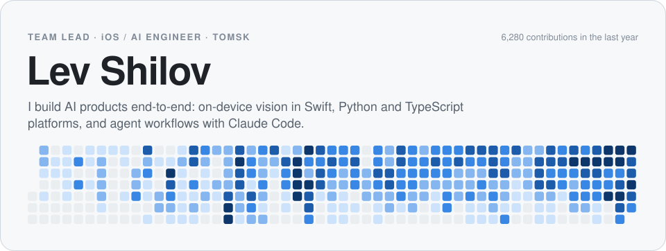
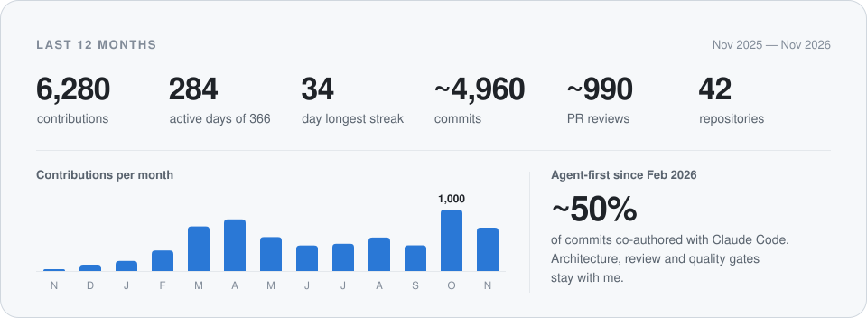
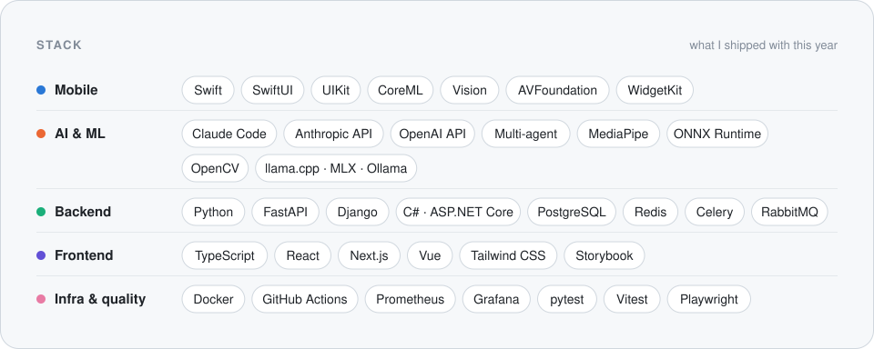

<picture>
  <source media="(prefers-color-scheme: dark)" srcset="assets/header-dark.svg">
  
</picture>

<picture>
  <source media="(prefers-color-scheme: dark)" srcset="assets/stats-dark.svg">
  
</picture>

<picture>
  <source media="(prefers-color-scheme: dark)" srcset="assets/stack-dark.svg">
  
</picture>

 

**Shipped** — [AIKynetix](https://ai.aikynetix.app) motion analytics (SaaS + [iOS apps](https://apps.apple.com/app/id1565394039)) · [Focusy](https://apps.apple.com/app/id6760561095) · [Юрист AI Pair](https://apps.apple.com/app/id6760489106) · [Forge](https://github.com/lionshilov/Forge), open-source agents for Claude Code

**Background** — 3 peer-reviewed papers on 3D reconstruction and computer vision ([MDPI, 2021](https://www.mdpi.com/1999-5903/13/12/315)) · TUSUR, GPA 4.9

 

  
  

